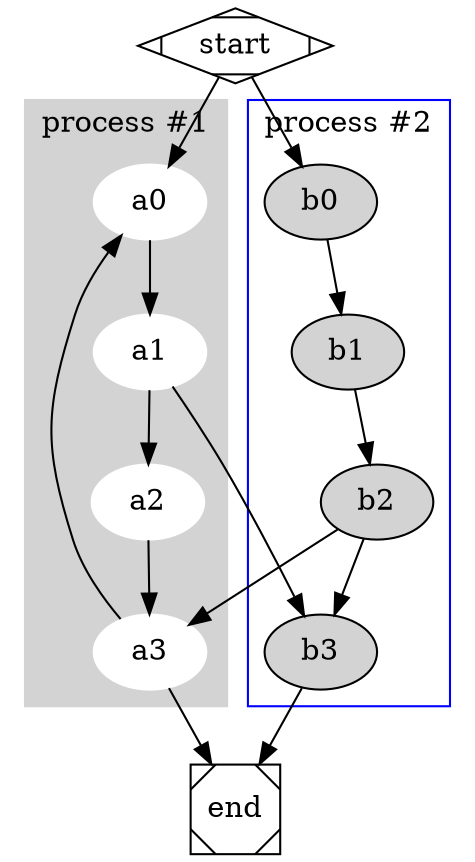
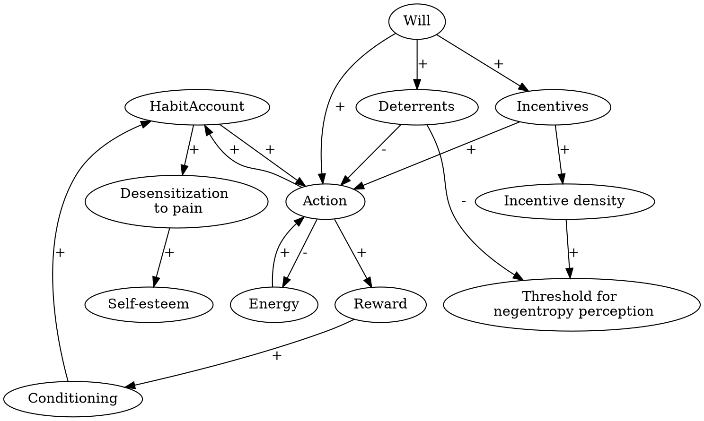

Complexity is a difficult beast to deal with. One of the core challenges of complexity is the strange independence between the parts and the whole. You may find yourself in a situation where learning about the parts doesn't help much with learning about the whole; sometimes, learning about the parts can even become misleading.

<%= insert_teaser caption: %Q{Photo by <a href="https://pixabay.com/users/cp17-1035078/">cp17</a> on <a href="https://pixabay.com/photos/english-bulldog-dog-sweet-charming-5422018/">Pixabay</a>} %>

But in many situations, we can't learn about the whole because we don't know the whole yet. This is, for example, the case for my research on the connection between habits, willpower, and actions. I have my suspicions and hypotheses. But I am not interested in focusing on a single causal mechanism to create an Instagrammable punchline.

I am looking at a complex web of factors, including phenomena such as psychological entropy, freedom of will, neurotransmitter levels, environmental cues, a sense of meaning, acrasia (~the state of not being in control), and connecting knowledge ranging from brain biochemistry to ancient Greek philosophy. I even include the Catholic Catechism in my considerations. The model is very complex because I combine many different entities from many different domains.

The biggest challenge is that I am working outside established research domains. If you are doing research on the brain, there are established rules, norms, and proven practices for tackling issues. Many norms, based on best practices and experience, guide studies on the role of dopamine or acetylcholine (two neurotransmitters) in habit formation or willpower.

But when you cross domains and connect philosophical knowledge of willpower with neurological knowledge of willpower, few established methods and techniques ensure you are not just talking out of your pocket.

The biggest gap is in technical processes that support research on complex issues.

To close the gap, I developed the GraphViz Bottom Up Research Technique.

## Tools

I can't guess at the whole because I don't know enough about it or its complexity.

So, I created a process that builds a model of the whole as a byproduct of my hyperfocusing on specific parts and their relationship. The goal of the process is to bridge the gap from narrow research to an integrated perspective on the complexity of the issue.

GraphViz is a tool for creating graphs from text input. You write this to get the graph below it:

So, I created a note that focuses on the ever-growing model. The note contains the graph code, which results in the graph below it:

In the code, you see that I link to individual notes. In these notes, I focus on establishing the connection or on precisely defining the entity that is part of the graph. I introduce the link with `//` to remove it from the graph output.

For now, I am focusing on building a simple stock-and-flow model (read the book *Thinking in Systems* for a deeper inquiry) that collapses the relationship between entities into either a reinforcing ("+") or a balancing relationship ("-"). A positive relationship holds if "More X means more Y" is true; a negative relationship holds if "More X means less Y" is true.

Such a model type is closely related to a concept map. The difference is that the stock-flow model defines concepts narrowly as buckets for something, and the relationship between buckets is positive, negative, or non-existent.

With this structure in place, I can focus on establishing individual relationships and ignore the whole for a while. But as a byproduct, I create a complex model (draft).

After some time, you can review the model that you created and work with it.

- You can try to spot missing gaps.
- You can identify long-chain feedback loops that aren't obvious.
- You can even point AI to the graph and ask it for specific model characteristics.

You start with a bottom-up approach to building the model. Then you move over to a bi-directionally informed approach to research.

## Conclusion

This simple technique is readily integrated into your Zettelkasten and allows you to perform research on complex issues over a long period of time.

For brevity, I kept it short and presented one version of this technique. This technique is part of a larger [tool family](https://zettelkasten.de/posts/anchored-model-layering/) for [long thinking](https://zettelkasten.de/posts/supercharging-long-thinking/) needed to deal with complex issues. But you can also use it for any complex issue. Based on this technique, I am building a structure that enables the integration of AI-automated research on investment issues. I know it is not a Zettelkasten-friendly example. My point is that this is a generalizable technique for learning and research for complex issues.

**What's the verdict then?** Dealing with complex research problems is a craft. And like any craft, it can be learned, practiced, and sharpened over time.

The GraphViz Bottom-Up Research Technique is a tool that gives you a way to do something tractable when the problem in front of you feels intractable. Instead of demanding that you understand the whole before you can begin, it lets you work on the parts and trust that the whole will gradually assemble itself as a byproduct of disciplined, focused work.
